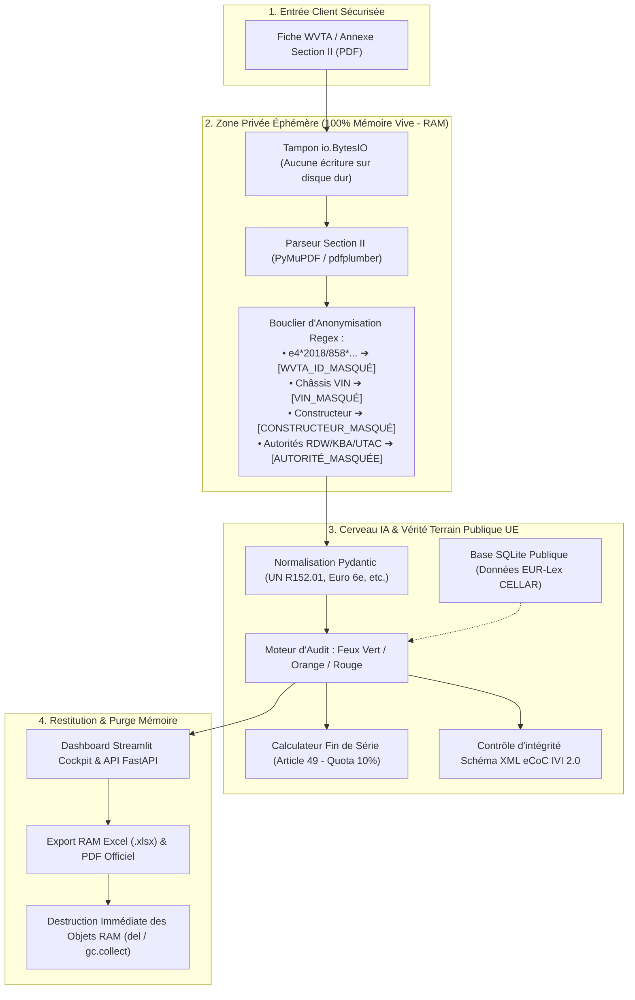
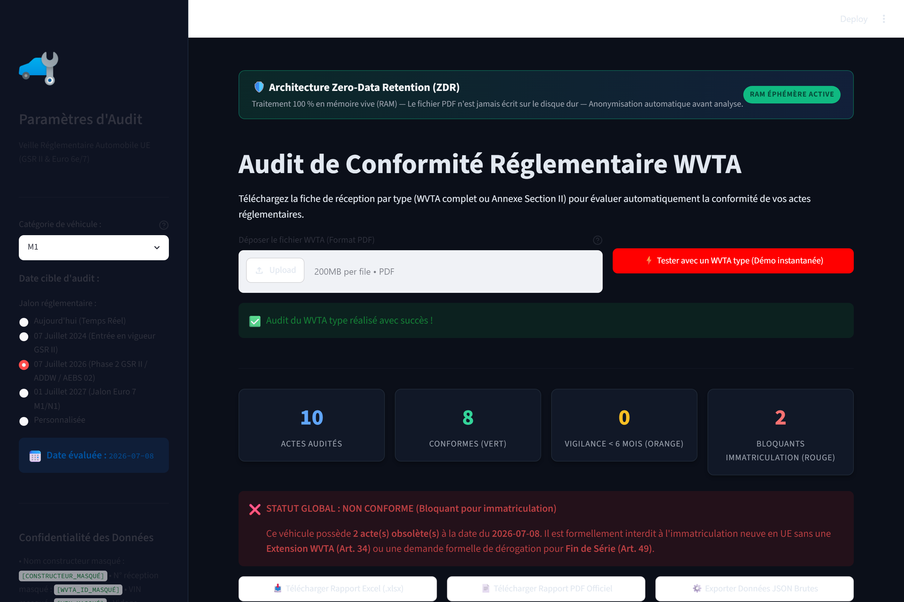
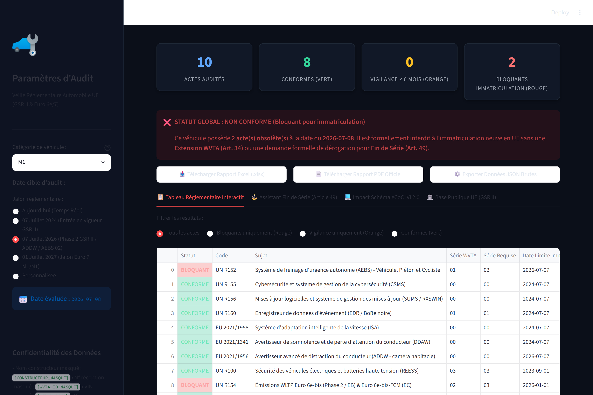
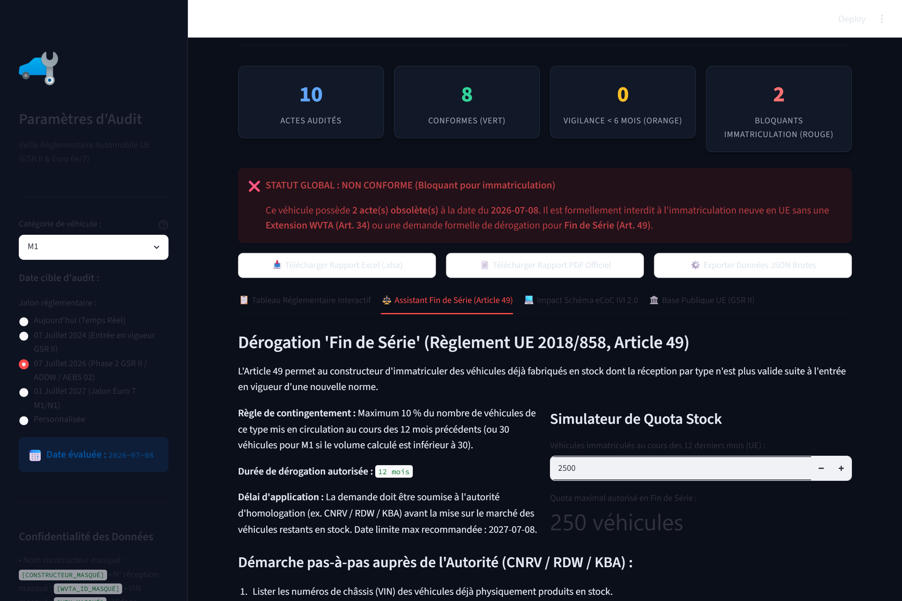
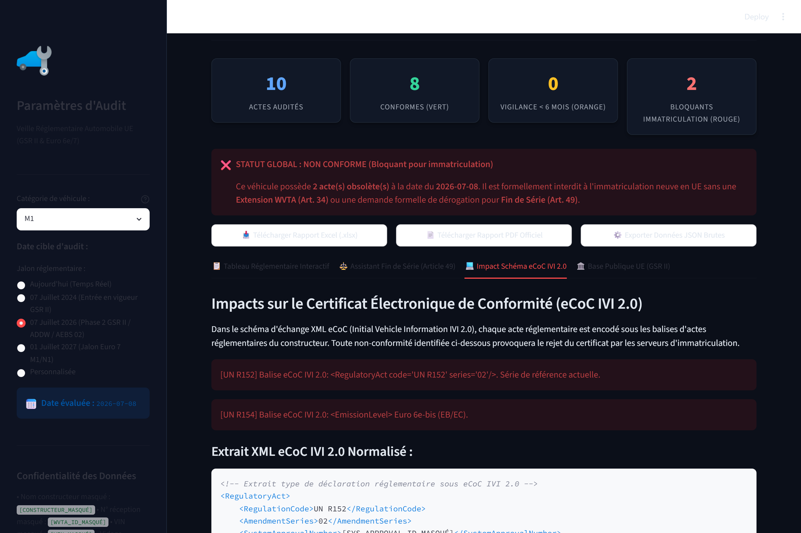

# 🛡️ Agent IA de Veille Réglementaire Automobile (WVTA / GSR II / Euro 6e-7)

[](https://www.python.org/)
[-10B981?logo=shield)](https://github.com/ayshaElb/wvta-regulatory-agent)
[%202018%2F858%20%7C%20GSR%20II-003399?logo=european-union)](https://eur-lex.europa.eu/)
[](https://streamlit.io/)
[](https://fastapi.tiangolo.com/)
[](https://sqlite.org/)

> **Agent IA d'homologation et d'audit de conformité réglementaire automobile (WVTA - Whole Vehicle Type Approval) conçu sous une architecture stricte *Zero-Data Retention* (ZDR).**  
> Analyse en mémoire vive les réceptions européennes, évalue la conformité vis-à-vis du **GSR II (Règlement UE 2019/2144)** et d'**Euro 6e/7**, calcule les contingents de **Fin de Série (Article 49)** et prévient les rejets dans le flux **eCoC IVI 2.0**.

---

## 🎯 Problématique Métier & Enjeux Constructeurs

L'industrie automobile européenne fait face à un durcissement sans précédent du calendrier d'homologation :
- **Règlement Général de Sécurité (GSR II - UE 2019/2144)** : Obligation de nouveaux systèmes actifs (AEBS piéton/cycliste R152.02, Cybersécurité CSMS R155, Mises à jour logicielles SUMS R156, Enregistreur de données d'événement EDR R160, Alerte de distraction ADDW).
- **Conséquence directe pour les constructeurs** : Tout véhicule neuf produit mais non conforme à la « Date C » (*Toutes Immatriculations*) est **strictement interdit à l'immatriculation** dans les 27 États membres de l'UE.
- **Le défi de la confidentialité** : Les fiches de réception WVTA renferment des données hautement confidentielles (variantes techniques, numéros de dossiers secrets, identité des fournisseurs, pré-séries). Aucun document client brut ne peut transiter sur des serveurs tiers ou être conservé sur disque.

---

## 🏗️ Architecture "Zero-Data Retention" (ZDR)



---

## 📸 Démonstration Visuelle & Captures d'Écran

### 1. Vue d'Ensemble & Tableau de Bord d'Audit Réglementaire
Attestation active de l'architecture *Zero-Data Retention*, synthèse des 4 indicateurs clés (Actes audités, Conformes, En vigilance < 6 mois, Bloquants) et verdict d'immatriculation :


---

### 2. Tableau Réglementaire Interactif & Feux Tricolores
Cartographie précise des séries d'amendements exigées à la date cible (ex: Jalon Phase 2 GSR II au 7 juillet 2026), détection des séries obsolètes (Rouge) et actions correctives recommandées :


---

### 3. Assistant & Simulateur de Contingent "Fin de Série" (Article 49)
Calculateur automatisé du contingent de véhicules en stock pouvant bénéficier de la dérogation légale de 12 mois (règle des 10 % du volume annuel d'immatriculations ou plancher de 30 véhicules pour la catégorie M1) :


---

### 4. Analyse d'Impact sur le Schéma XML eCoC IVI 2.0
Vérification des balises techniques du Certificat Électronique de Conformité (`<RegulatoryAct>`, `<SystemApprovalNumber>`, `<CyberSecurityManagementSystem>`) afin d'éviter le blocage immédiat des téléprocédures d'immatriculation (SIV en France, RDW aux Pays-Bas, KBA en Allemagne) :


---

## ⚡ Les 5 Piliers Techniques de la Solution

1. **Zone Privée Éphémère (In-Memory Processing)** : Le fichier PDF est consommé via un flux binaire `io.BytesIO`. Il n'existe aucun répertoire `/uploads`, aucune écriture sur disque dur et aucun historique client n'est persisté.
2. **Bouclier de Confidentialité (Regex Scrubber)** : Nettoie automatiquement les en-têtes constructeurs, signatures RDW/KBA, tampons de services techniques (UTAC) et numéros de série internes avant toute inférence IA.
3. **Vérité Terrain Publique EUR-Lex CELLAR** : Moteur SQL alimenté par les textes consolidés de l'Annexe II du Règlement 2018/858, du GSR II 2019/2144 et connecté au SPARQL officiel de l'Office des publications de l'Union européenne.
4. **Moteur d'Audit Métier Spécialisé** :
   - 🟢 **CONFORME** : Série d'amendement conforme à la date d'immatriculation visée.
   - 🟡 **VIGILANCE** : Série valide mais échéance « Date C » dans moins de 180 jours.
   - 🔴 **BLOQUANT** : Série périmée rendant l'immatriculation du véhicule illégale en Europe sans extension ou dérogation.
5. **Génération de Rapports Directe en RAM** : Exports instantanés sous formats **Excel (.xlsx)** stylisé multi-onglets et rapport officiel **PDF (.pdf)** générés en mémoire vive.

---

## 🚀 Démonstration Publique

Pour exécuter la démonstration publique en ligne de commande :

```bash
# Cloner le dépôt vitrine
git clone https://github.com/ayshaElb/wvta-regulatory-agent.git
cd wvta-regulatory-agent

# Lancer la démonstration publique
python demo_showcase.py
```

### Exemple de sortie console :
```text
===========================================================================
🛡️  WVTA REGULATORY WATCH AI - ZERO-DATA RETENTION DEMO
===========================================================================

[INFO] Initialisation de la session éphémère (Traitement 100% en RAM)
[INFO] Données client masquées automatiquement avant traitement :
       • Constructeur ➔ [CONSTRUCTEUR_MASQUÉ]
       • Numéro WVTA  ➔ [WVTA_ID_MASQUÉ]
       • Numéro VIN   ➔ [VIN_MASQUÉ]

[1/3] Analyse d'un document WVTA type (Catégorie M1)...
      Date cible d'audit : 2026-07-08 (Jalon Phase 2 GSR II)

[2/3] Résultats de la détection de conformité :
  🔴 [UN R152] Freinage d'urgence autonome (AEBS - piétons et cyclistes)
     Série document: 01 | Série requise: 02 ➔ BLOQUANT (Rouge)
  🟢 [UN R155] Cybersécurité et gestion CSMS
     Série document: 00 | Série requise: 00 ➔ CONFORME (Vert)
  🟢 [UN R156] Mises à jour logicielles (SUMS / RXSWIN)
     Série document: 00 | Série requise: 00 ➔ CONFORME (Vert)

[3/3] Diagnostic Métier & Dérogation Fin de Série (Article 49) :
  • Base légale : Règlement (UE) 2018/858, Article 49 'Fin de série'
  • Sur une base de 2500 véhicules/an, quota maximal éligible : 250 unités.
  • Période maximale de grâce : 12 mois à compter de la date d'expiration.

[OK] Démonstration terminée. La mémoire vive a été purgée avec succès.
===========================================================================
```

---

## 🔒 Politique de Confidentialité & Code Source Propriétaire

Ce dépôt public constitue la **vitrine technologique et fonctionnelle (Showcase)** du projet.  
Conformément à l'architecture **Zero-Data Retention**, le code source de production des moteurs d'inférence, parseurs internes et algorithmes d'analyse confidentiels (`src/`, `api/`) est maintenu sous licence privée.

---

## 📬 Contact & Expertise

Pour toute demande d'intégration industrielle, d'audit homologation ou d'accès au moteur complet :
- **Auteur & Architecture** : [ayshaElb](https://github.com/ayshaElb)
- **Spécialité** : Homologation Automobile UE, Réglementation GSR II / Euro 7, eCoC IVI 2.0 & IA Souveraine.
